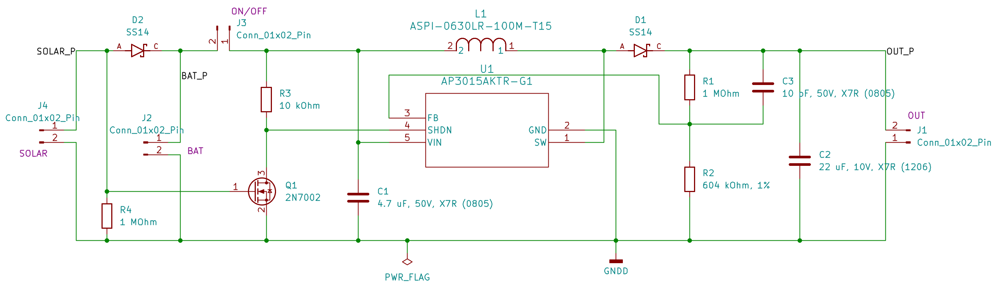
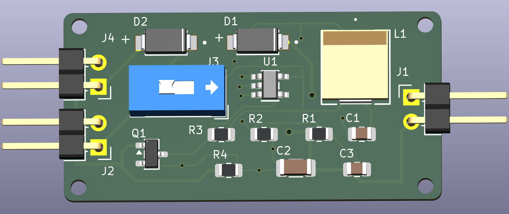
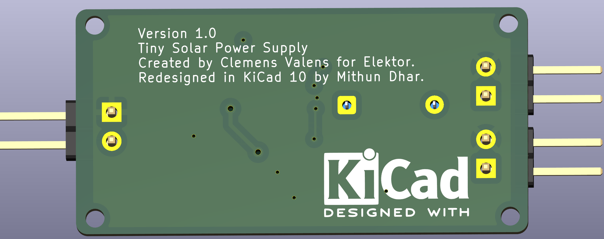
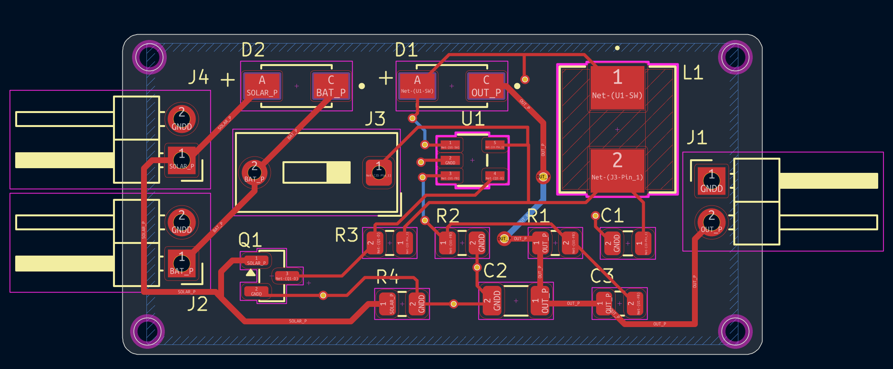

# Tiny Solar Power Supply (KiCad 10)

A compact switching voltage regulator PCB designed in **KiCad 10** for solar and battery-backed low-power loads, adapted from Clemens Valens's Elektor design as part of the **PCB Design with KiCad** course by **Peter Dalmaris** on Udemy.

---

## 📸 3D Renders & Layout

### Schematic


### Top & Bottom 3D Views



### PCB Layout


---

## 🛠️ Circuit & Hardware Overview

* **Switching Voltage Regulator (`U1` – AP3015AKTR-G1):** Steps up input power through a `10 µH` inductor (`L1`, `ASPI-0630LR-100M-T15`) and Schottky rectifier (`D1`, `SS14`) to generate `OUT_P`.
* **Feedback & Filtering:** Uses a `1 MOhm` (`R1`) and `604 kOhm` (`R2`) feedback network with `C3` (`10 pF`, 50V, X7R, 0805) and output capacitor `C2` (`22 µF`, 10V, X7R, 1206), plus `C1` (`4.7 µF`, 50V, X7R, 0805) on the input rail.
* **Solar, Battery & Switch Control:** Features 2-pin headers for `SOLAR` (`J4`), `BAT` (`J2`), and `OUT` (`J1`), an `SS14` diode (`D2`) between `SOLAR_P` and `BAT_P`, a `2N7002` N-channel MOSFET (`Q1`) with `R3` (`10 kOhm`) and `R4` (`1 MOhm`), and an `ON/OFF` switch (`J3`).
* **Custom Libraries & Git Setup:** Keeps project symbol/footprint libraries under `Libraries/` and uses `.gitattributes` to manage KiCad files cleanly across commits.

---

## Acknowledgements & Course Credit

This project was built following the **PCB Design with KiCad by Peter Dalmaris** course on Udemy, based on the original concept by Clemens Valens for Elektor and redesigned in KiCad 10. 

**Key skills practiced:**
* Schematic capture and footprint assignment in KiCad 10.0.
* Routing 2-layer PCB stackups.
* Setting up custom Net Classes for power rails.
* Managing EDA files and PCB branch merges using Git and GitHub Desktop.

---

**Designed by Mithun**

---

## 📁 Repository Structure

```text
├── Libraries/                  # Project symbol/footprint libraries
├── Tiny Solar Power Supply/    # KiCad 10 schematic and PCB files
├── assets/                     # Schematic, PCB Layout, and 3D Views
├── 220321-01.pdf               # Reference design document
├── .gitattributes              # Git attributes configuration for KiCad files
└── README.md
